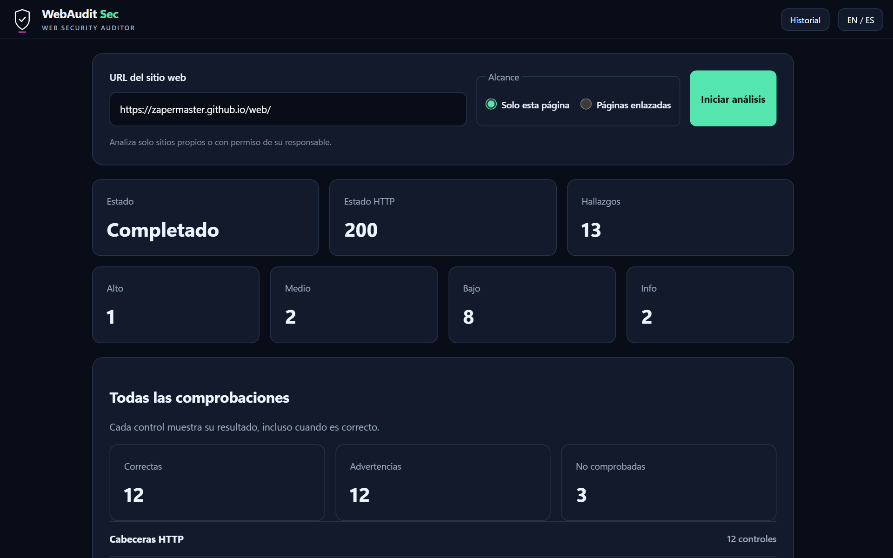
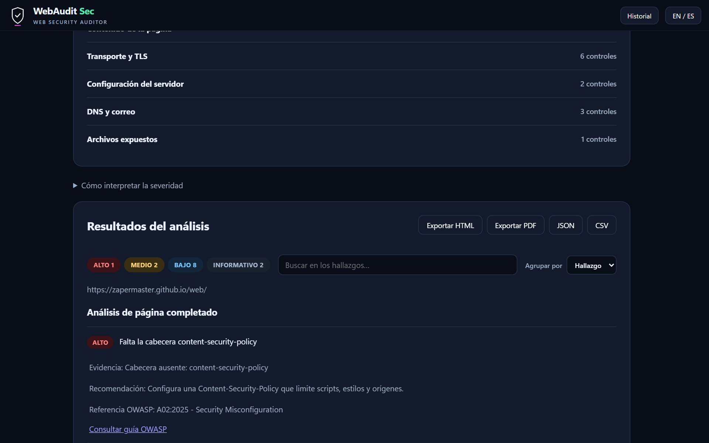
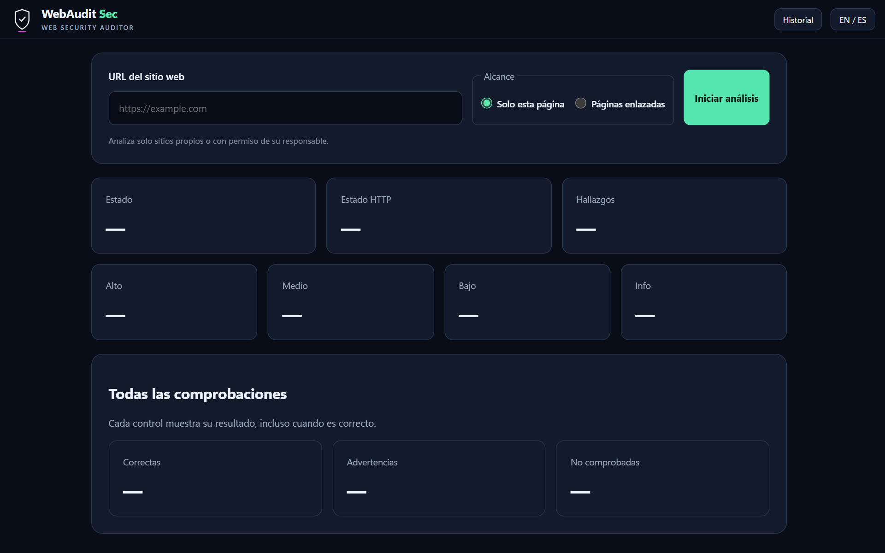

# WebAudit Sec

[](https://github.com/ZaperMaster/WebAudit-Sec/actions/workflows/tests.yml)

[](LICENSE)

Auditor de seguridad web: analiza una página o todo un sitio (cabeceras, cookies, TLS,
contenido mixto, DNS…) y explica cada hallazgo con su recomendación y su referencia OWASP.

El proyecto tiene **dos formas de usarse**, que comparten el mismo motor de análisis:

| | Qué es | Dónde está | Cómo se arranca |
|---|---|---|---|
| **Web** | Servidor + interfaz en el navegador | [`web/`](web/) | `python -m web` → http://127.0.0.1:8000 |
| **App de escritorio** | Programa de Windows (`WebAudit-Sec.exe`) | [`desktop/`](desktop/) | `python -m desktop` o el `.exe` |

El `.exe` ya compilado se publica en la sección **Releases** del repositorio, no en el código.

## Capturas

<p align="center">
  
</p>

| Detalle de un hallazgo | Pantalla inicial |
|---|---|
|  |  |

<sub>Análisis de una sola página de la web del propio autor (zapermaster.github.io).</sub>

## Estructura

```
webaudit/                Motor de análisis (compartido por la web y la app)
  scanner/               Comprobaciones: cabeceras, cookies, TLS, DNS, HTML, rastreo...
  jobs.py                Análisis en segundo plano: progreso y cancelación
  history.py             Historial de análisis guardado en disco
web/                     Versión web           → ver web/README.md
  server.py              API (FastAPI)
  static/                Interfaz (HTML, CSS y JavaScript)
desktop/                 App de escritorio     → ver desktop/README.md
  window.py              Ventana WebView2 con barra de título propia
  build_windows.bat      Crea dist\WebAudit-Sec.exe
  assets/                Icono de la app
tests/                   Tests del motor, la API y la interfaz
requirements.txt         Dependencias del motor y la web
```

## Qué analiza

- **Cabeceras de seguridad**: CSP (incluido `report-only`, `nonce` y `hash`), HSTS,
  X-Frame-Options, Referrer-Policy, Permissions-Policy, CORS...
- **Cookies**: Secure, HttpOnly, SameSite, prefijos `__Host-`/`__Secure-` y cookies de
  sesión con caducidad muy larga.
- **TLS**: certificado (caducado, autofirmado, de otro dominio, cadena incompleta),
  clave y firma, versiones aceptadas y revocación (OCSP o CRL).
- **Contenido de la página**: contenido mixto, SRI en scripts y estilos de terceros e
  icono servido por HTTP.
- **DNS y correo**: SPF, DMARC y CAA.
- **Servidor**: información expuesta, versiones sin soporte, métodos HTTP y security.txt.
- **Archivos expuestos**: `.git`, `.env`, copias de seguridad, phpinfo, server-status...
- **Rastreo**: enlaces del mismo dominio y `sitemap.xml`, con límites configurables.

Los resultados se agrupan, se filtran, se comparan con el análisis anterior del mismo
sitio y se exportan a PDF, HTML, JSON o CSV, en español o en inglés.

> Analiza solo sitios propios o con permiso de su responsable.

## Desarrollo

```
py -3 -m venv .venv
.venv\Scripts\python.exe -m pip install -r desktop\requirements.txt
.venv\Scripts\python.exe -m pytest
```

`desktop\requirements.txt` incluye todo lo de la web; para trabajar solo con la web basta
con `requirements.txt`.

## Licencia

[MIT](LICENSE). Antes de usar la herramienta, lee [SECURITY.md](SECURITY.md): analiza solo sitios
propios o con permiso de su responsable.

## Autor

Hecho por [ZaperMaster](https://github.com/ZaperMaster).
